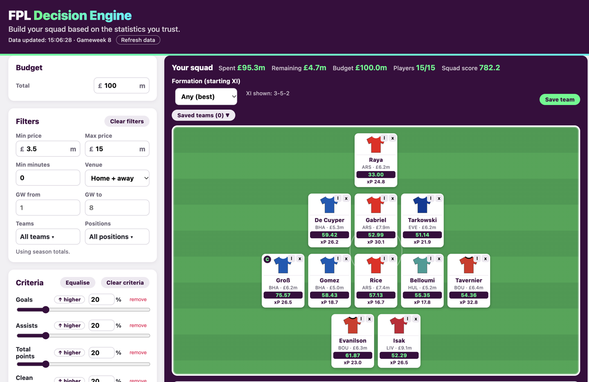

# FPL Decision Engine

A Fantasy Premier League assistant that turns live FPL data into decisions. You choose which stats matter to you, it ranks every player, builds the best legal 15-man squad within your budget, and tells you who to transfer, captain and bench over the next few gameweeks, including against the rivals in your mini-league.

**[Open the live tool](https://fpl-data-engine.vercel.app)**



## What it does

- **Ranks every player your way.** Pick any FPL stats as criteria (goals, assists, points, clean sheets, defensive contribution, xG, cards, price...), give each a weight, and choose whether higher or lower is better. Scores run from 0 to 100, over the whole pool or per position, for the full season, a gameweek range, or home/away games only.
- **Generates your ideal squad.** One click builds the highest-scoring legal squad (2 GKP, 5 DEF, 5 MID, 3 FWD, max 3 per club, within budget) with the best starting XI and captain. You can lock players in, exclude others, and ask for a formation such as 3-4-3 or 4-4-2.
- **Predicts expected points (xP).** Each player gets an xP forecast for the next 1 to 8 gameweeks, built from minutes, xG, xA, clean-sheet odds, saves, bonus and defensive contribution, adjusted for each opponent's strength. Double gameweeks are summed and blank ones count as zero.
- **Gives weekly advice.** The Advice panel suggests the best one- and two-transfer plans by xP gain (and says when a -4 hit is worth it), the top captain and vice-captain picks, fixture swings, easiest upcoming runs, bench swaps, and injury or low-minutes flags.
- **Plays your mini-league.** Enter your FPL team ID and league ID to see the standings, your gap to the leader, and your rivals' picks. The tool works out effective ownership and labels players as differentials or cover, so you can chase or protect your position.
- **Loads your real team.** "Load my team" puts your current squad on the pitch with your real bank, and you can save and reload squads to compare plans.

## How it works

1. **Live data.** Everything comes from the official FPL API (players, fixtures, gameweek history, leagues) through a small proxy, so the tool is always up to date. Nothing is bundled and no FPL data is stored in your browser.
2. **Scoring.** Each chosen stat is min-max normalised across the pool and multiplied by its weight. Weights always add up to 100, so a player's score is between 0 and 100.
3. **Squad generator.** The generator picks the best-scoring players first while keeping enough budget to fill the remaining slots, then improves the squad one swap at a time until no swap helps. Locked players stay, excluded ones never appear.
4. **Expected points.** For each fixture the model estimates minutes played, then adds appearance points, goals and assists (from xG and xA per 90, scaled by the opponent's defence), clean-sheet and goals-conceded points (from the team's expected goals conceded, scaled by the opponent's attack), saves, bonus and defensive contribution. All formulas are documented at the top of [`src/lib/xp.ts`](src/lib/xp.ts).
5. **Advice.** Transfer plans keep the bank above zero and the 3-per-club rule. In mini-league mode, a player's value is weighted by effective ownership: xP × (1 − EO) when chasing, xP × (1 + EO) when protecting a lead. Details are in [`src/lib/advice.ts`](src/lib/advice.ts).

## Accuracy and limitations

- The xP model follows FPL scoring rules and public expected-goals data, but it has not yet been back-tested against actual gameweek points. Treat it as a guide, not a guarantee.
- The squad generator is a fast heuristic, not a proven optimum. It usually finds a very strong squad, but a better one may exist.
- Expected minutes rely on recent minutes and the official availability flag, so rotation and late team news can still surprise it.
- Free Hit and Wildcard planning and price-change prediction are not built yet.

70 unit tests cover scoring, the squad generator, xP, advice, mini-league and saved teams (`npm test`).

## Run it locally

Use Node 20 or later.

```bash
npm install
npm run dev      # Vite dev server; /api/fpl/* is proxied to https://fantasy.premierleague.com/api/*
npm test         # Vitest unit tests
npm run build    # type-check + production build
```

**Deploy to Vercel:** import the repo (framework preset: Vite). `api/fpl.ts` is deployed as a serverless function (the client calls `/api/fpl?path=<path>`) that forwards GET requests to the FPL API, which avoids CORS. Responses are edge-cached for 5 minutes, and the header shows when data was fetched with a "Refresh data" button. `vercel.json` adds an SPA fallback.

## Project structure

```
src/App.tsx               main screen: criteria, filters, player table, squad builder
src/fpl.ts, src/api.ts    FPL data types, fetching and gameweek re-aggregation
src/scoring.ts            weighted 0-100 player score
src/squad.ts              squad generator, formations, starting XI and captain
src/lib/xp.ts             expected points model
src/lib/advice.ts         transfers, captaincy, fixture swings, bench and flags
src/lib/league.ts         mini-league standings and rival picks
src/*.tsx                 pitch, advice panel, xP chart, player profile, mini-league
src/test/                 Vitest suites and fictional test data
api/fpl.ts                serverless proxy to the FPL API
```

## Data sources

- Official Fantasy Premier League API (`fantasy.premierleague.com/api`): players, teams, fixtures, gameweek history, team strength ratings and classic league standings.

FPL data belongs to the Premier League and is used here for analysis.

## Author

Built by Thomas ([@ThomasMavro](https://github.com/ThomasMavro)) during the MSc in Sport Analytics & AI at Loughborough University London.
